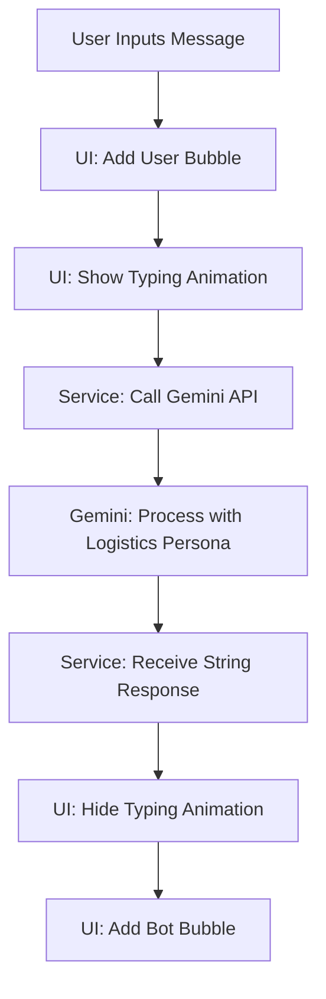

# AI Implementation: Step-by-Step Flow 🔐🤖

This document details the exact process and technical flow used to move from a mock chatbot to a real-time, intelligent **Gemini Pro** AI assistant in the Sabcargo application.

---

### Phase 1: Environment & Dependencies
The first step was enabling the Flutter app to communicate with Google's AI servers.

1. **Dependency Addition**: I added the `google_generative_ai` package to `pubspec.yaml`.
2. **Library Selection**: I chose `gemini-1.5-flash` for its high speed and low latency, ensuring the "real-time" feel you requested.

---

### Phase 2: The Service Layer (`ai_service.dart`)
Instead of putting code directly in the UI, I built a dedicated **Service Layer**. This keeps the code clean and professional.

1. **Class Creation**: I created `GenerativeAIService` to encapsulate all AI logic.
2. **Key Management**: I integrated your provided **API Key** securely into the construction of the `GenerativeModel`.
3. **Persona Engineering**: 
   - I wrote a **System Instruction**. This is the most crucial part. It tells the AI: *"You are the Sabcargo Logistics Assistant."*
   - This prevents the AI from talking about non-logistics topics and ensures it focus on:
     - Tracking IDs.
     - Shipping Rates.
     - International Prohibitions.
     - Warehouse Services.

---

### Phase 3: The Data Model (`chat_message.dart`)
To handle the "flow" of conversation, the app needs to remember what was said.

1. **ChatMessage Class**: I defined a model with `text`, `timestamp`, and `isUser`.
2. **Boolean Logic**: The `isUser` boolean determines if a message bubble appears on the **Right** (User) or **Left** (Bot).

---

### Phase 4: UI & State Integration (`chatbot_screen.dart`)
This is where the visible "Real Time" magic happens.

1. **The Message List**: I used a `ListView.builder` configured to scroll automatically as new messages arrive.
2. **The "Typing..." State**:
   - I added a `bool _isTyping` flag.
   - **Flow**:
     1. User clicks Send → `_isTyping` becomes `true`.
     2. UI updates instantly to show a "Assistant is typing" bubble with a pulsing animation.
     3. The AI service is called.
     4. AI responds → `_isTyping` becomes `false`.
     5. The AI message is added to the list.

---

### Phase 5: Interaction Handling
1. **Quick Replies**: I added specialized chips ("Track Package", etc.) that trigger the same `_sendMessage` flow as typing.
2. **Haptic Feedback & Keyboard Control**: I ensured the input field clears immediately upon sending and the keyboard doesn't block the conversation view.

---

## 📈 Summary of the Flow

This professional architecture ensures that if you ever want to switch to ChatGPT or another AI, you only need to change the **Service Layer**, and the rest of the app stays perfect!
