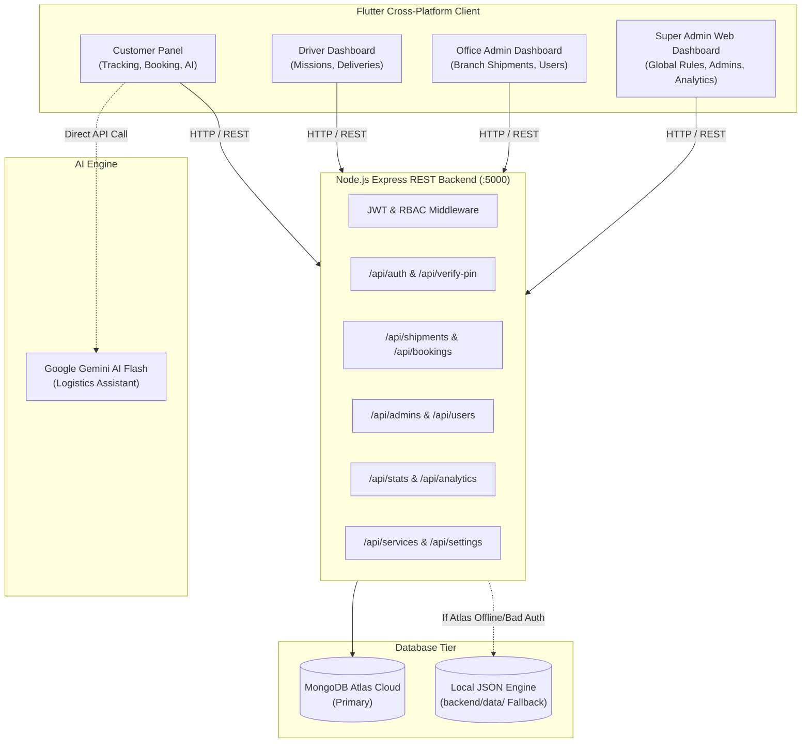

# SabCargo Enterprise Logistics Platform 🚚
### Complete Architecture, Technical Specification & Developer Documentation

---

## 📌 1. Project Overview

**SabCargo** is a cross-platform logistics and cargo management ecosystem. It provides end-to-end package tracking, booking, regional office dispatch, fleet management, and administrative governance.

The platform consists of two primary subsystems:
1. **Frontend Mobile & Web Client:** Built with **Flutter (Dart)** supporting Android, iOS, Web, and Desktop.
2. **Backend REST API:** Built with **Node.js, Express, and MongoDB** (with MongoDB Atlas support and an automatic local document fallback engine).

---

## 🏛️ 2. System Architecture



---

## 👥 3. Roles & Permissions (RBAC)

The system enforces strict Role-Based Access Control via JWT claims:

| Role | Target UI | Description & Permissions |
| :--- | :--- | :--- |
| **SuperAdmin** | `/superadmin` (Web only) | Global platform governor. Manages office admins, cargo services, system settings, global rules, audit logs, and system analytics. |
| **Admin (Office Admin)** | `/admin` (Mobile/Web) | Regional branch manager. Manages shipments originating/destined for their specific branch (e.g. Dubai Central, London Heathrow). |
| **Driver** | Driver Dashboard | Field logistics agent. Views assigned delivery missions and updates real-time delivery status. |
| **User (Customer)** | `/home` | General consumer. Books shipments, tracks packages with timelines, uses AI assistant, and manages their account. |

---

## 🔑 4. Authentication & Security Flow

- **Permanent PIN Access:** Users log in using a 6-digit PIN. The PIN is hashed using `bcryptjs` with salt rounds = 10 before storage.
- **OTP Verification:** Registration uses a 6-digit one-time code sent to email via Nodemailer SMTP.
- **JWT Tokens:** Issued on PIN verification (`/api/verify-pin`) with a 7-day expiration time and payload containing `sub` (User ID), `email`, and `role`.
- **Automatic Role Routing:** The client reads the decoded role from the token and directs the user to their designated dashboard.

### Default Credentials (Seeded Automatically)
| Account | Email | Default PIN | Assigned Role / Branch |
| :--- | :--- | :--- | :--- |
| **Super Admin** | `admin@sabcargo.com` | `123456` | SuperAdmin |
| **Dubai Admin** | `office@sabcargo.com` | `123456` | Admin (Dubai Central) |
| **Karachi Admin** | `karachi@sabcargo.com` | `123456` | Admin (Karachi Port) |
| **London Admin** | `london@sabcargo.com` | `123456` | Admin (London Heathrow) |
| **Demo Driver** | `driver@sabcargo.com` | `123456` | Driver (Dubai Central) |
| **Demo Customer**| `user@sabcargo.com` | `123456` | User (Hamza Ahmad) |

*Development Mock PIN Bypasses:*
- `888888`: Instant Super Admin session (Web)
- `999999`: Instant Office Admin session
- `777777`: Instant Driver session

---

## 💾 5. Database Architecture & Collections

The backend interacts with MongoDB via [`backend/database.js`](file:///c:/Users/hp/.gemini/antigravity/scratch/sabcargo/backend/database.js). It includes dual-engine support:

1. **MongoDB Atlas Mode:** Connects to cloud cluster via `MONGODB_URI`.
2. **Resilient Local Fallback Engine:** If Atlas credentials fail auth or network is offline, the backend activates a persistent file-backed JSON database in `backend/data/` ensuring 100% continuous uptime.

### Collection Schemas

- **`users`**: Customer and operator profiles (`id`, `fullName`, `email`, `phone`, `pinHash`, `isVerified`, `isActive`, `role`, `assignedOffice`, `createdAt`).
- **`admins`**: Administrative roles & permissions (`id`, `fullName`, `email`, `phone`, `role`, `branch`, `isActive`, `permissions`).
- **`shipments`**: Cargo records (`id`, `trackingNumber`, `userId`, `userEmail`, `itemName`, `origin`, `destination`, `status`, `expectedDate`, `weight`, `type`, `branchId`, `steps: []`, `createdAt`).
- **`bookings`**: Customer booking requests (`bookingId`, `userId`, `itemName`, `cargoType`, `fromCity`, `toCity`, `senderName`, `receiverName`, `total`, `createdAt`).
- **`services`**: Cargo types (`id`, `name`, `description`, `iconCode`, `colorValue`, `isActive`).
- **`systemSettings`**: Key-value settings (`officeLocations`, `globalRules`).
- **`systemLogs`**: Audit trail of administrative and auth events (`userEmail`, `action`, `details`, `createdAt`).
- **`userOtps`**: Verification codes for registration and password reset (`userId`, `otpHash`, `expiresAt`, `used`).
- **`notifications`**: User and broadcast announcements (`id`, `title`, `body`, `sentBy`, `targetRole`, `targetEmail`, `sentAt`).
- **`counters`**: Auto-increment counter state for relational IDs.

---

## 🌐 6. Backend API Reference

### Health & Diagnostic
- `GET /api/health` - Ping database, returns engine mode (`mongodb-atlas` or `local-fallback`).

### Authentication
- `POST /api/auth/register` - Start registration, sends OTP email.
- `POST /api/auth/verify-otp` - Validates code and establishes permanent PIN.
- `POST /api/auth/set-pin` - Sets custom PIN.
- `POST /api/verify-pin` - Authenticates 6-digit PIN, issues JWT token and role.
- `GET /api/auth/me` - Validates current token and refreshes role.
- `POST /api/auth/request-pin-reset` - Sends recovery PIN.

### Shipments & Bookings
- `GET /api/shipments` - Fetches shipments (filtered by user or branch).
- `POST /api/shipments` - Create or update shipment (Admin/SuperAdmin).
- `POST /api/bookings` - Submit new booking from customer app.
- `PATCH /api/shipments/:trackingNumber/steps` - Append a new timeline step and update status.
- `DELETE /api/shipments/:trackingNumber` - Cancel shipment.

### Admins & Users Management
- `GET /api/admins` - List all administrators (SuperAdmin).
- `POST /api/admins` - Add/update administrator.
- `DELETE /api/admins/:id` - Delete administrator.
- `PATCH /api/admins/:id/toggle-active` - Toggle admin status.
- `GET /api/users` - List users (scoped to branch for Office Admins).
- `PUT /api/users/:id` - Update user details.
- `DELETE /api/users/:id` - Delete user account.
- `PATCH /api/users/:id/toggle-active` - Lock/Unlock user access.

### Analytics, Services & Settings
- `GET /api/stats` - Summary counts for shipments, status breakdown, and active users.
- `GET /api/analytics` - Time-series trend data and KPI metrics.
- `GET /api/logs` - Audit logs.
- `GET /api/services` - List available cargo services.
- `POST /api/services` - Create cargo service (Admin/SuperAdmin).
- `GET /api/settings/:key` - Retrieve system configuration.
- `POST /api/settings` - Update configuration (SuperAdmin).

---

## 🤖 7. AI Assistant (Gemini)

- **Model:** `gemini-1.5-flash` via `google_generative_ai`.
- **Location:** [`lib/services/ai_service.dart`](file:///c:/Users/hp/.gemini/antigravity/scratch/sabcargo/lib/services/ai_service.dart).
- **Persona:** Specialized SabCargo logistics advisor trained with company-specific rules:
  - Allowed/prohibited items (hazardous materials, perishables).
  - Volumetric weight formulas: $(L \times W \times H) / 5000$.
  - Transit estimates and insurance policies.

---

## 🚀 8. Setup & Development Guide

### 1. Prerequisites
- **Node.js** (v18.x or v20.x+)
- **Flutter SDK** (v3.22+ or latest stable)
- **PowerShell** (Windows) or Terminal (macOS/Linux)

### 2. Configure Backend (`backend/.env`)
```env
PORT=5000
MONGODB_URI=mongodb+srv://<USER>:<PASSWORD>@cluster0.jwiq9ec.mongodb.net/cargoApp?retryWrites=true&w=majority&appName=SabCargo
MONGODB_DB=cargoApp
JWT_SECRET=sabcargo_jwt_secure_key_2026_dev_prod_auth

# Optional Email Settings (for live OTP delivery)
SMTP_HOST=smtp.gmail.com
SMTP_PORT=587
SMTP_USER=your_email@gmail.com
SMTP_PASS=your_app_password
SMTP_FROM=SabCargo Support <your_email@gmail.com>
```

### 3. Launch the Backend
```powershell
cd backend
npm install
npm start
```
*Run API integration tests:*
```powershell
npm test
```

### 4. Launch the Flutter App
```powershell
# Run on connected device, emulator, or chrome
flutter run

# To run SuperAdmin Web Dashboard explicitly:
flutter run -d chrome
```

---

## 📁 9. Directory Structure

```text
sabcargo/
├── backend/                        # Node.js Express REST API
│   ├── data/                       # Local persistent JSON database store
│   ├── database.js                 # Unified MongoDB & local fallback engine
│   ├── server.js                   # Express API endpoints & middleware
│   ├── test_api_endpoints.js       # Automated test suite
│   ├── migrate_sql_to_mongodb.js   # SQL Server to MongoDB migration script
│   └── .env                        # Server configuration & credentials
│
├── lib/                            # Flutter Client Application
│   ├── admin/                      # Admin & Super Admin modules
│   │   ├── screens/                # Dashboards, office manager, rules, services
│   │   ├── services/               # Admin HTTP service layer
│   │   └── widgets/                # Role guards and admin controls
│   ├── core/                       # Design tokens, theme, responsive breakpoints
│   ├── models/                     # Data models (Shipment, ChatMessage)
│   ├── screens/                    # User screens (Home, Tracking, Booking, PIN)
│   ├── services/                   # ApiService, AuthService, AiService
│   └── main.dart                   # Application bootstrap & route configuration
│
└── PROJECT_DOCUMENTATION.md        # Comprehensive technical guide
```

---

© 2026 SabCargo Advanced Logistics Framework. All rights reserved.
